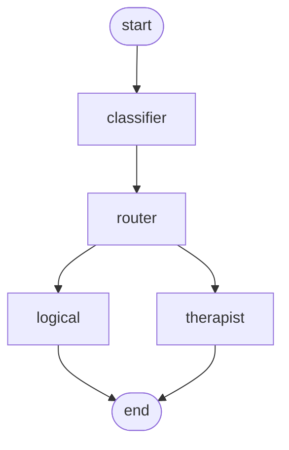

<div align="center">
  
</div>

<h1 align="center">Building intelligent systems that think, route, and respond.</h1>

<p align="center">
  
  
  
  
  
</p>

<p align="center">
  I build conversational AI, agent workflows, and routing systems that turn complex ideas into useful, scalable experiences.
</p>

---

## 🧠 Core focus

- Agentic workflows and orchestration
- LLM-powered chat and routing systems
- Prompt engineering and conversational UX
- LangChain / LangGraph application design
- End-to-end AI product prototyping

---

## 🔀 Architecture I work with



This is the kind of flow I design for multilingual, multi-intent conversational systems: classify first, route intelligently, then deliver the right response path.

---

## 🛠️ Tech stack

```bash
Python
LangChain
LangGraph
OpenAI / Anthropic APIs
FastAPI
PostgreSQL
Docker
Git & GitHub
```

---

## 📌 What I’m building

- Smart AI assistants that understand intent and context
- Routing layers for task-specific agents
- Reliable pipelines for conversational logic
- Practical LLM apps that are useful beyond demos

---

## 🌱 Currently exploring

- Multi-agent systems
- Context-aware orchestration
- Production-grade LLM application patterns
- Better human-AI interaction design

---

## 📈 GitHub snapshot

<p align="center">
  
</p>

> Replace the username in the stat URL with your actual GitHub username to personalize it.

---

## 🤝 Let’s connect

- Open to AI engineering collaborations
- Building practical LLM products
- Interested in agentic systems, automation, and thoughtful UX

<p align="center">
  <a href="https://github.com/your-username"></a>
  <a href="https://www.linkedin.com/in/your-profile"></a>
</p>

> Update the GitHub and LinkedIn links with your real profile URLs.

---

<p align="center">
  <i>Turning ideas into intelligent systems, one workflow at a time.</i>
</p>
